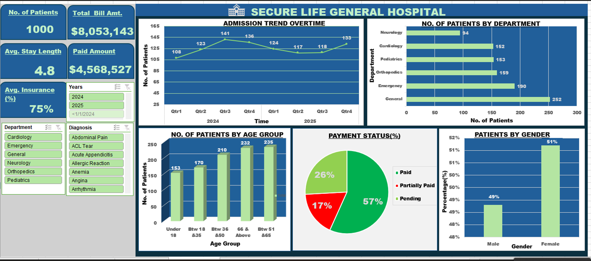

# SECURE HEALTH GENERAL HOSPITAL PERFORMANCE DASHBOARD(2024-2025)

## INTRODUCTION 

This report presents an analysis of patient admission records and financial performance at Secure Life General Hospital. The main purpose of this project is to help the management of Secure Life General Hospital to understand its operational performance, monitor payments and improve decision making.

## ABOUT THE DATASET
The analysis is based on the hospital's dashboard, which provides insights into patient visits, departmental performance, admission trends, average length of stay, billing, payment status, age distribution and gender distribution.The primary objective of this analysis is to provide management with meaningful insights into hospital operations, identify areas of strong performance and highlight areas requiring further attention to support effective decision-making.
*To see dataset*:[click here](Hospital_Patients_Dataset.xlsx)

## PROBLEM STATEMENT 
This project seeks to explore changes in patient admissions, outstanding medical bills,  variations in insurance coverage across it's departments ,among others .

## VISUALIZATION 

Microsoft Excel was used to design and develop this dashboard for analyzing patients' data in Secure Life General Hospital.

## INSIGHTS
**Patient Visits Recorded**: The  hospital recorded a total of 1,000 patient visits for the year 2024 and 2025.
The admission trend across the eight quarters is presented below:

Q1 2024                   =       108, 
Q2 2024                   =       123, 
Q3 2024                   =       141, 
Q4 2024                   =       136, 
Q1 2025                   =       124, 
Q2 2025                   =       117, 
Q3 2025                   =       118, 
Q4 2025                   =       133, 
Total                     =       1,000

-The hospital recorded its highest number of admissions in Q3 2024, with 141 patients.
The lowest admission figure was recorded in Q1 2024, with 108 patients.
Patient admissions increased steadily from Q1 to Q3 2024 before experiencing a slight decline in Q4 2024.
In 2025, admissions declined during the first two quarters but gradually recovered in the second half of the year.
The hospital ended Q4 2025 with 133 patient visits, indicating an improvement compared to the beginning of 2024.

**Highest Number of Patients**: The General Department recorded the highest patient attendance, with 252 patients, representing 25.2% of total visits.

-The Emergency Department ranked second, receiving 190 patients (19%).

-Orthopedics followed with 159 patients, representing 15.9%.

-Pediatrics and Cardiology recorded relatively similar patient numbers, with 153 and 152 patients respectively.

-Neurology recorded the lowest number of patients, with 94 visits (9.4%).

 **Department that generated the highest total bills**: The dashboard displays the hospital's overall billed amount as: $8,053,143.
However, the dashboard does not provide a departmental breakdown of the total billing amount.
Therefore, it is not possible to accurately identify which department generates the highest revenue from the available information.
Although the General Department recorded the highest number of patients (252), this does not automatically mean it generates the highest total bills. Different departments may charge different amounts depending on the nature of treatment, medical procedures, medications and other services provided.

**Average Length of Stay for Patients Across Different Departments**: The hospital recorded an overall average patient length of stay of 4.8 days.
This means that patients admitted to Secure Life General Hospital spent an average of approximately 4.8 days receiving treatment and care before discharge.
Differences in patient conditions, treatment requirements, medical procedures and recovery rates may influence the length of hospitalisation across departments.

**Proportion of Patient Bills**:

Paid                             =   57%, 
Partially Paid                   =    17%, 
Pending                          =    26%, 
Total                            =   100%
Analysis and Findings:

Paid (57%): More than half of the recorded patient bills have been fully settled. This indicates that the hospital has achieved a reasonable level of payment collection.
Partially Paid (17%): A further 17% of patient bills have received partial payments. These accounts still require follow-up to recover their outstanding balances.
Pending (26%): Approximately one-quarter of patient bills remain unpaid, indicating a significant amount of outstanding patient obligations.

The findings show that although the hospital has received payments for 57% of its recorded bills, 43% of patient accounts are either partially paid or pending.

**How Much Has the Hospital Billed, and How Much Remains Outstanding?**
Total Amount Billed    = $8,053,143,  
Total Amount Paid      = $4,568,527, 
Outstanding Balance

$3,484,616
Calculation of Outstanding Balance:

Outstanding Balance = Total Amount Billed − Total Amount Paid

= $8,053,143 − $4,568,527

= $3,484,616

Analysis and Findings:
The hospital generated a total bill of $8,053,143 during the period under review.
Out of this amount, $4,568,527 has been successfully collected, leaving an outstanding balance of $3,484,616.
This means:

Approximately 56.7% of the total billed amount has been collected.

Approximately 43.3% remains outstanding.

The findings indicate that a considerable proportion of the hospital's billed revenue is yet to be recovered.
This may affect the hospital's cash flow and its ability to meet operational expenses, purchase medical supplies, maintain equipment and provide quality healthcare services.

**Patient Distribution by Age Group**:Patients aged between 51 and 65 recorded the highest attendance, with 235 patients.
Patients aged 66 and above followed closely with 232 patients.
The 36–50 age group recorded 210 patients.
Patients below 18 years recorded the lowest attendance, with 153 patients.

**Patient Distribution by Gender**:
-Female patients accounted for 51% of total visits.

-Male patients accounted for 49%.

The difference between male and female patient attendance is relatively small. The hospital has a relatively balanced gender distribution, with slightly higher female attendance.

**Average Insurance Coverage**:
The dashboard indicates an average insurance coverage of 75%.
This suggests that a substantial proportion of the hospital's patient population is associated with health insurance coverage.

## RECOMMENDATIONS
Based on the findings from the analysis, the following recommendations are proposed:

1. Improve Revenue Collection:

Management should strengthen payment monitoring and debt recovery procedures to reduce the outstanding balance of $3,484,616 by :

-Implementing regular follow-ups on outstanding patient accounts.

-Sending payment reminders to patients with unpaid balances.

-Establishing clear payment arrangements for patients who cannot settle their bills immediately.

-Improving billing documentation and payment tracking.

-Monitoring outstanding balances regularly to minimise revenue leakage.2. Optimise Departmental Resources.

-More attention should be given to the General and Emergency Departments because they recorded the highest patient attendance.

2. Monitor Patient Admissions:

Management should continuously monitor quarterly admission trends to identify factors influencing increases and decreases in patient visits.

3. Improve Patient Management:
   
The hospital should monitor patient length of stay across individual departments to improve bed utilisation, discharge planning and healthcare delivery.

4. Strengthen Insurance Partnerships:
 
Management should improve its engagement with health insurance providers to ensure timely processing of claims and reimbursements.

5. Enhance Data-Driven Decision-Making:

The hospital should expand its dashboard to include departmental revenue, departmental average length of stay, outstanding balances by department and monthly revenue collection trends.

## CONCLUSION

The analysis of Secure Life General Hospital's performance dashboard provides valuable insights into the hospital's operational activities, patient distribution and financial position.

With a total of 1,000 recorded patient visits, the hospital demonstrates activity across its six major departments. The General Department recorded the highest patient attendance, while Neurology recorded the lowest.

Financially, the hospital generated $8,053,143 in total bills and successfully collected $4,568,527, leaving an outstanding balance of $3,484,616. This highlights the need for improved payment monitoring and revenue collection strategies.

Furthermore, the hospital recorded an average patient length of stay of 4.8 days, while the payment status analysis revealed that 43% of patient accounts are either partially paid or pending.

Overall, the findings suggest that Secure Life General Hospital can improve its operational efficiency and financial performance by strengthening revenue collection, optimising departmental resources, improving patient management and adopting a more comprehensive data-driven management approach.

The ultimate goal is to transform hospital data into actionable insights that support better financial management, efficient healthcare delivery and improved patient satisfaction.

